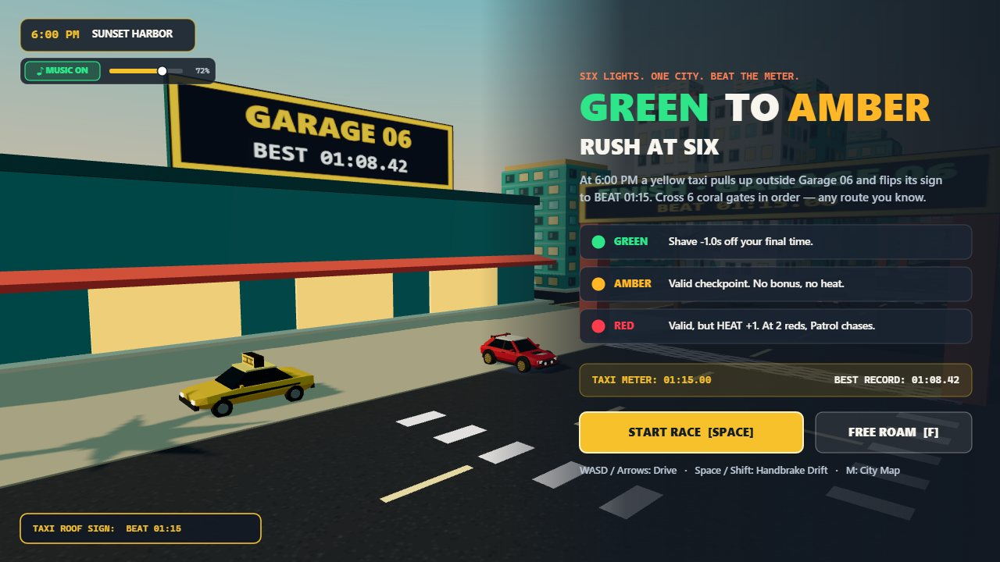
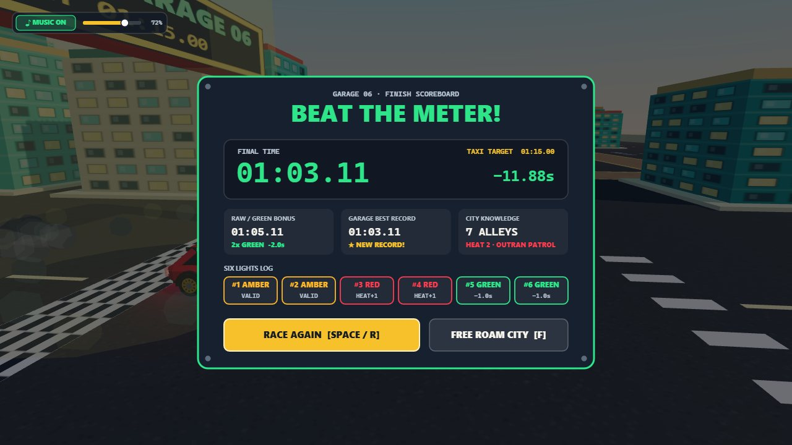

# Green to Amber: Rush at Six



An offline 3D free-route city racing game built with Three.js and procedural Web Audio — zero build step, zero external network requests.

At 6:00 PM in Sunset Harbor, a yellow taxi pulls up outside **Garage 06** and flips its roof sign to **BEAT 01:15**. Pick any route through the city's avenues, cobblestone shortcut alleys, and the **Citrus Plaza** roundabout to clear all **6 Coral Traffic-Light Gates** in order and cross the finish arch before the `01:15.00` taxi meter runs out.

## Screenshots

| Race Gameplay | Patrol Chase | Finish Scoreboard |
| :---: | :---: | :---: |
|  |  |  |

## How to Play

### Traffic-Light Gate Rules
Each of the 6 Coral Gates cycles live through Green, Amber, and Red signals:
- **GREEN**: Shave **-1.0s** off your final time.
- **AMBER**: Valid checkpoint — no bonus, no heat.
- **RED**: Valid checkpoint, but adds **+1 HEAT**. Running **2 Red Lights** dispatches a **Police Patrol Car** to chase and ram you.

### Controls
- `W` / `↑` — Accelerate
- `S` / `↓` — Brake / Reverse
- `A` / `D` or `←` / `→` — Steer
- `Space` / `Shift` — Handbrake Drift (also `Space` / `Enter` to start from menus)
- `M` / `Tab` — Toggle Full City Route Map
- `R` — Quick Retry Race
- `F` — Free Roam Mode (explore Sunset Harbor at your own pace)
- `N` — Toggle Original Sunset Funk-Synth Music On/Off (plus on-screen volume slider)
- `P` / `Esc` — Pause / Resume

## Running Offline Locally

Requires Node.js 22+ (no install, no build step, 100% offline):

```bash
node serve.ts
```

Then open `http://localhost:8080` in a desktop browser and click **START RACE** (or press `Space`) to launch the race and start the original procedural Web Audio soundtrack.

## Packaging & Validation

To validate the offline game bundle and generate `game/`, `screenshots/`, and `dossier.json` into a local output directory:

```bash
MAKEFUN_OUTPUT_DIR=./out node main.ts
```

## License

See [LICENSE](LICENSE).
