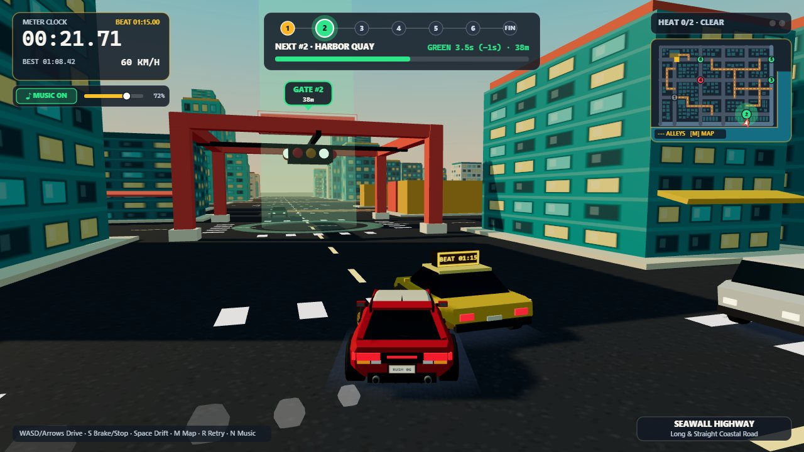
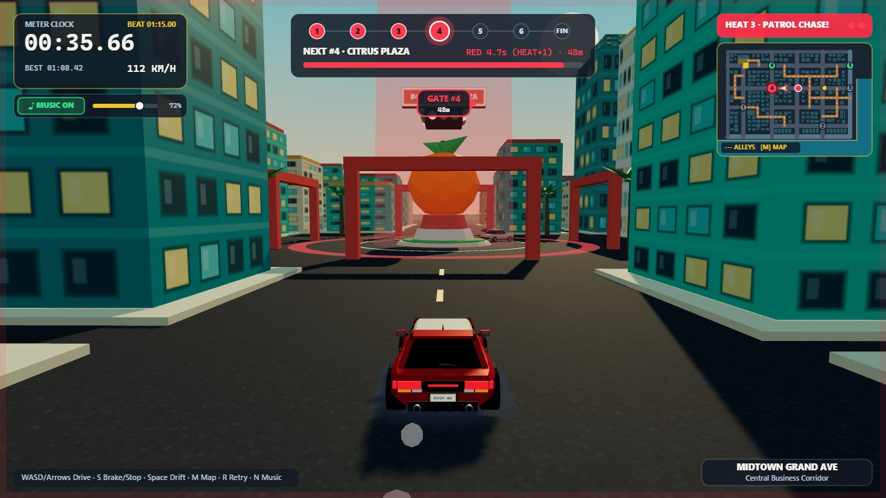

# Green to Amber: Rush at Six

[](https://make.fun/bounty/gta6-01?utm_source=github&utm_medium=readme&utm_campaign=gta6-01)
[](https://make.fun/bounty/gta6-01/leaderboard?utm_source=github&utm_medium=readme&utm_campaign=gta6-01)
[](https://make.fun/bounty/gta6-01/leaderboard?utm_source=github&utm_medium=readme&utm_campaign=gta6-01)

An offline 3D free-route city racing game set in **Sunset Harbor**.

At 6:00 PM outside **Garage 06**, a **Yellow Taxi** flips its roof sign to **`BEAT 01:15`**. Carve your own route through golden-hour avenues, tight **cobblestone alleys**, and the **Citrus Plaza** roundabout to clear all **6 Coral Traffic-Light Gates** in order before the taxi meter expires—backed by an original procedural **Sunset Funk-Synth** Web Audio soundtrack.

## Screenshots

| Start Screen | Racing Sunset Harbor |
| :---: | :---: |
|  |  |

| Patrol Chase | Finish & Results |
| :---: | :---: |
|  |  |

## Traffic-Light Gate Rules

Each of the **6 Coral Traffic-Light Gates** cycles live through Green, Amber, and Red signals:

- **GREEN**: Shave **`-1.0s`** off your final time.
- **AMBER**: Valid checkpoint — no bonus, no heat.
- **RED**: Valid checkpoint, but adds **`+1 HEAT`**. Running **2 Red Lights** triggers a **Patrol Chase** as a police cruiser hunts and rams you.

## Controls

- `W` / `↑` — Accelerate
- `S` / `↓` — Brake / Reverse
- `A` / `D` or `←` / `→` — Steer
- `Space` / `Shift` — Handbrake Drift (also `Space` / `Enter` to start from menus)
- `M` / `Tab` — Toggle Full City Route Map
- `R` — Quick Retry Race
- `F` — Free Roam Mode (explore Sunset Harbor at your own pace)
- `N` — Toggle Sunset Funk-Synth Music On/Off (plus on-screen volume slider)
- `P` / `Esc` — Pause / Resume

## Run it

Requires Node.js 22+ (no install, no build step, zero network requests):

```bash
node serve.ts
```

Open `http://localhost:8080` in a desktop browser and click **START RACE** (or press `Space`) to launch the race and start the procedural Web Audio soundtrack.

To package and validate the offline bundle (`game/`, `screenshots/`, and `dossier.json`) into a local output folder:

```bash
MAKEFUN_OUTPUT_DIR=./out node main.ts
```

---

Built for the make.fun competition — explore more at [make.fun](https://make.fun/?ref=4vfb3cp2&utm_source=github&utm_medium=readme&utm_campaign=gta6-01).
